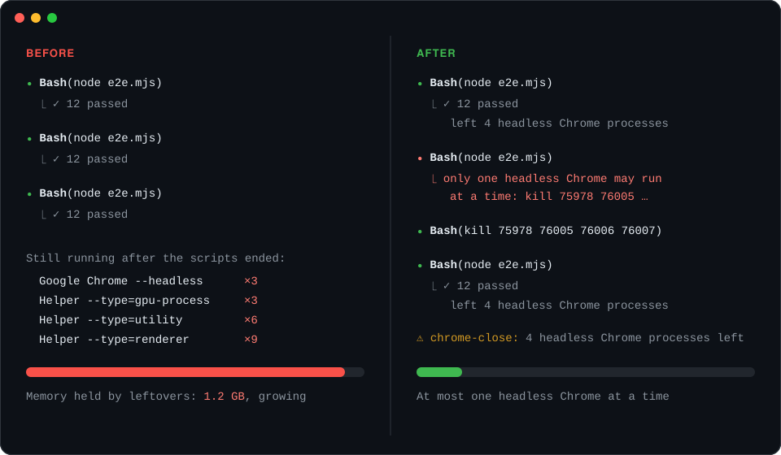

# chrome-close

<p align="center">
  <strong>One headless Chrome at a time.</strong><br>
  A Claude Code mod that refuses a new headless Chrome while another one, or the helpers it left behind, still runs.
</p>

<p align="center">
  <a href="CHANGELOG.md"></a>
  <a href="LICENSE"></a>
  <a href="https://code.claude.com/docs"></a>
  <a href="hooks/register.ts"></a>
  <a href="hooks/register.test.ts"></a>
</p>

<p align="center">
  <a href="#features">Features</a> ·
  <a href="#install">Install</a> ·
  <a href="#usage">Usage</a> ·
  <a href="#development">Development</a> ·
  <a href="CONTRIBUTING.md">Contributing</a> ·
  <a href="CHANGELOG.md">Changelog</a>
</p>



*Illustration of a session before and after.*

A browser test that closes only Chrome's main process leaves its renderer, GPU and utility helpers running. Each run Claude starts adds more, and memory use climbs. chrome-close checks for a running headless Chrome before Claude runs a command that may start one, refuses the command while any remains, and tells Claude which processes to end.

> [!NOTE]
> chrome-close is built on Claude Code's function-hooks mod API, which is in early access and may change between releases.

## Features

- **One at a time:** A Bash or PowerShell command that may start a headless Chrome is refused while another headless Chrome runs.
- **macOS, Linux and Windows:** Lists processes with `ps`, or on Windows through PowerShell's `Win32_Process` when `ps` is missing or is Git Bash's.
- **Catches leftovers:** Chrome helpers orphaned after their headless browser exited count as running, so they block the next launch until they are ended.
- **Says what to end:** The refusal lists the PIDs and the command to end them in the shell Claude used: `kill`, `Stop-Process` in PowerShell, or `taskkill //F //PID ...` in Git Bash on Windows, and Claude is told after a command that left processes behind. A command that moved to the background is reported as still running, not as finished.
- **Status line:** Shows how many headless Chrome processes are running or left, and clears once a `kill` ends them.
- **Cleanup always runs:** `kill`, `pkill`, `killall`, `ps`, `pgrep`, `lsof`, `top`, `htop`, `taskkill`, `tasklist`, `Stop-Process`, `Get-Process`, `Get-CimInstance` and `Get-WmiObject` are never refused.
- **Says when it cannot check:** If no process listing works, the command runs, the status line reads `cannot list processes; launches are not checked`, and Claude is told the launch was not checked.
- **Your Chrome is left alone:** A desktop Chrome or Edge and its helpers are not counted, and the mod never kills anything itself.

| Command Claude runs | While a headless Chrome or leftover helpers run |
| --- | --- |
| `node shot.mjs --headless`, `npx playwright test`, `node puppeteer-test.js` | Refused, with the PIDs to end |
| `kill 901 902`, `pkill -f "Chrome for Testing"` | Runs |
| `git status`, `cd chrome-close`, `grep -ri chromium src` | Runs |

## Install

In a Claude Code **terminal** session, run:

```
/plugin install chrome-close --marketplace AnnihilationWizard/chrome-close
```

1. Answer `y` to add the `github:AnnihilationWizard/chrome-close` marketplace.
2. Choose a scope. The **user** scope loads the mod in every session.
3. Claude Code confirms `Installed chrome-close. Plugin is now active.` The mod works in the current session without a restart.

It is also listed in the [AnnihilationWizard/mods](https://github.com/AnnihilationWizard/mods) marketplace as `chrome-close@annihilationwizard-mods`.

To update later, run `claude plugin update`, then `/reload-plugins`.

<details>
<summary>Run from a local clone instead</summary>

```bash
git clone https://github.com/AnnihilationWizard/chrome-close.git
claude --plugin-dir ./chrome-close
```

To load a clone in every session, add it to the `env` block of `~/.claude/settings.json`:

```json
{
  "env": { "CLAUDE_CODE_PLUGIN_DIRS": "/path/to/chrome-close" }
}
```

</details>

## Usage

Once installed, there is nothing to configure. When Claude tries to start a headless Chrome while one still runs, it reads a refusal such as:

```text
chrome-close: only one headless Chrome may run at a time, and 2 headless Chrome process(es)
still running (PID 901 902). Wait for it to finish, or end the leftovers first: kill 901 902
```

### What counts as a launch

A Bash or PowerShell command with a part, split at `;`, `&&`, `||`, `|` and line ends outside quotes (Bash escapes with `\`, PowerShell with a backtick; a quote left open is also read without quotes), that contains `--headless`, `headless-shell`, `puppeteer`, `playwright`, `selenium`, `lighthouse`, `chromedp` or `webdriver`, unless that part starts with a command that only reads, inspects or ends processes. A command that only mentions Chrome, such as a path or a commit message, is not a launch.

Parts that start with these are never launches: `cat`, `head`, `tail`, `less`, `more`, `grep`, `egrep`, `fgrep`, `rg`, `ag`, `ack`, `find`, `ls`, `dir`, `echo`, `printf`, `wc`, `sort`, `uniq`, `cut`, `jq`, `diff`, `file`, `stat`, `which`, `where`, `git`, `findstr`, `Get-Content`, `type`, `Select-String`, `Get-ChildItem`, `Get-Item`, `Test-Path`, `Where-Object`, `Select-Object`, `Sort-Object`, `Measure-Object`, `Format-Table`, `Format-List`, `Out-String`, `Write-Output`, `Write-Host`, and the cleanup commands below. These still count as launches when they run another command: `find` with `-exec`, `-execdir`, `-ok` or `-okdir`, `git bisect run` or `git -c`, and `rg --pre`. `awk` and `sed` are not read-only, as they can run commands.

In PowerShell, a part that starts with a quoted string only outputs it, so it is not a launch; a quoted program is run with `&` in front. So `Select-String playwright package.json` and `Stop-Process -Id 1,2 -Force; "headless-shell left: $(...)"` run while a headless Chrome is up, but `cat notes.txt; npx playwright test` is refused.

### What counts as running

From `ps -axww`, or on Windows from PowerShell's `Get-CimInstance Win32_Process`: a Chrome, Chromium or Microsoft Edge executable started with `--headless`, every process beneath it, and their helper processes (`--type=renderer`, `gpu-process`, ...) left without their browser: re-parented to `launchd`/`init`, or on Windows with a parent that no longer exists. Edge counts because Playwright runs it for `channel: 'msedge'`. A shell that launched Chrome is not counted, and neither is WebView2 (`msedgewebview2.exe`), the Edge that Windows apps such as Teams embed.

### Limitations

- Only commands Claude runs through Bash or PowerShell are checked. Tests you run in another terminal, an IDE or CI are not limited.
- The mod does not end processes. Leftovers keep their memory until someone kills them, and they block every launch until then.
- A command that starts Chrome without any of the keywords, such as `npm test`, is not refused beforehand. Leftovers it creates are still reported when it ends. The same holds for a launch that reaches a shell only as text, such as `echo "chrome --headless" | sh`, or through a PowerShell string's `$(...)`.
- A command run in the background is not checked for leftovers when it returns.
- If neither `ps` nor PowerShell can list processes, the command runs unchecked rather than blocking the shell; the status line and a note to Claude say so.
- On Windows, each check starts `powershell.exe`, which is slower than `ps` and delays launch commands. Windows support is covered by tests with recorded listings and has not been run on a Windows machine yet.

## Development

```bash
claude plugin validate .   # manifest, marketplace file and hooks module
claude plugin test .       # hooks/*.test.ts against the engine
```

After Claude Code first loads the mod, it writes the API types to `.claude-plugin/types/` (git-ignored). Type-check against them with TypeScript 5.4 or newer:

```bash
npx -p typescript@5 tsc -p .
```

Run `claude --plugin-dir .` to try changes. In an interactive session the folder is watched, and saving a file reloads the mod.

## Project Structure

```text
.claude-plugin/   plugin.json manifest and marketplace.json
hooks/            hooks.json, the hooks module and its tests
docs/images/      README illustration
```

## Contributing

Bug reports and ideas are welcome. Read [CONTRIBUTING.md](CONTRIBUTING.md) before opening an [issue](https://github.com/AnnihilationWizard/chrome-close/issues) or pull request, and follow [SECURITY.md](SECURITY.md) for security reports.

## License

[MIT License](LICENSE). Copyright © 2026 [AnnihilationWizard](https://github.com/AnnihilationWizard).
